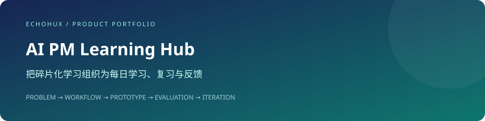

# AI PM Learning Hub · AI 产品经理知识打卡站

> 把碎片化学习组织为每日学习、复习与反馈。

  

**在线体验：** [打开产品](https://echohux.github.io/ai-pm-learning-hub/) · [验收与迭代记录](./docs/EVALUATION.md)



## 项目简介

面向 AI 产品经理学习者的日常知识打卡工具。根据仓库内使用文档与更新记录，线上应用提供知识卡、复习队列、知识库、学习统计和账号进度同步。当前公开仓库主要承担访问入口和使用说明。

项目重点解决以下问题：

- 学习碎片化：用结构化知识卡组织每日学习任务。
- 缺少反馈：通过打卡与统计呈现学习投入。
- 设备切换：通过账号与云端进度连接不同设备的学习记录。

## 核心能力

- 每日知识学习、打卡与复习队列。
- 知识库浏览、学习统计与 AI 辅助学习体验。
- 邮箱验证码注册、密码登录与免登录体验。
- 通过 CloudBase 保存账号资料及学习进度。
- GitHub Pages 提供跳转到腾讯云托管页面的短入口。

## 产品流程 · Pipeline

```text
GitHub Pages 入口 → 腾讯云托管页面
    ↓
邮箱验证码注册 / 密码登录
    ↓
学习知识卡 → 完成每日打卡
    ↓
进入复习队列 → 查看知识库与统计
    ↓
云端保存学习进度 → 同账号跨设备继续
```

以上业务能力依据仓库已有使用说明与更新记录整理；当前 `index.html` 仅含重定向，没有提供完整线上应用源码，不能据此核实内部 AI 实现或宣称 Agent / RAG 架构。

## 评测闭环

将核心任务、状态反馈与稳定性分开验收，再保留失败样例进行回归：

| 层级 | 验收关注点 |
| --- | --- |
| 结果质量 | 核心流程是否完成，输出或记录是否符合输入 |
| 过程质量 | 必要状态、异常反馈、数据一致性与可恢复性 |
| 稳定性 | 刷新与重复操作、依赖故障、存储或发布边界 |

```text
体验核心流程 → 记录实际结果 → 标注 Good / Bad / Boundary Case
      ↑                                      ↓
回归同一组用例 ← 修复并对比结果 ← 定位规则 / 数据 / 交互 / 依赖原因
```

这是本次补充的验收与迭代规范，尚未代表已经完成评测、建立自动化平台或取得量化成绩。项目专属用例与待填写记录见 [EVALUATION.md](./docs/EVALUATION.md)。

## 技术架构

- 访问入口：根目录 `index.html`，通过 meta refresh 和 JavaScript 跳转。
- 线上应用形态：已有文档描述为 HTML / CSS / JavaScript 单文件 Web 应用。
- 云服务：已有文档描述使用 CloudBase 认证与 `users`、`user_progress` 集合。
- 使用与发布记录：`docs/使用说明.md`、`CHANGELOG.md`。

**技术栈：** HTML · CSS · JavaScript · Tencent CloudBase · GitHub Pages。

## 本地运行

预览本仓库入口：

```bash
python3 -m http.server 8080
```

打开 `http://localhost:8080/` 会跳转到线上页面。该命令只验证跳转入口，不会在本地运行完整学习应用。独立复现需要另外取得完整应用源码并配置 CloudBase。

## 部署

GitHub Pages 承载入口页；实际应用位于入口指向的腾讯云托管地址。更新学习功能需要修改实际应用并部署到对应托管环境，不能仅修改本仓库入口。CloudBase 的登录方式、安全域名与数据库权限配置见 [使用说明](./docs/使用说明.md)。

## 项目结构

```text
index.html               # 线上应用重定向入口
docs/使用说明.md         # 注册登录、同步与云配置说明
CHANGELOG.md             # 已记录的版本变化
LICENSE                  # MIT 许可证
```

## 产品取舍与边界

登录与同步依赖公网及 CloudBase。当前仓库不包含完整应用源码；跨设备同步、AI 辅助和免登录行为需要在线验收。不要把文档中描述的能力写成已通过本次测试。

## 项目背景

项目通过 Vibe Coding 构建，产品关注点包括需求定义、任务流程、交互优先级与快速验证。本次说明文档参考 [FlowCraft AI](https://github.com/FILPPED-jin/FlowCraft-AI-Product) 的项目展示结构，按本仓库实际内容重新组织。

## License

[MIT License](./LICENSE)
