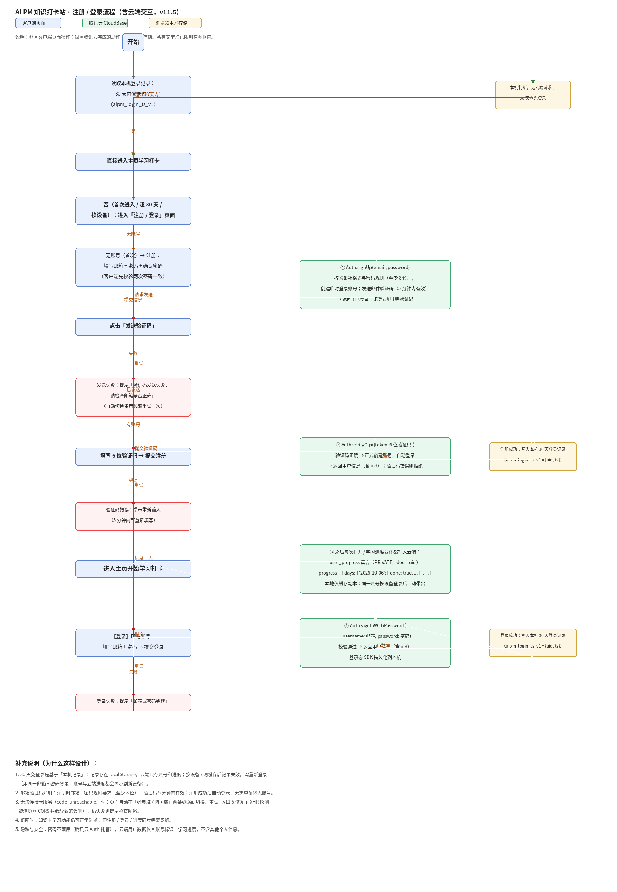

# AI PM Learning Hub

一款面向 AI 产品经理的轻量知识学习与每日打卡应用。通过知识卡片、间隔复习、学习统计和 AI 辅助生成，把碎片化知识整理成可以每天坚持的学习流程。

[在线体验](https://echohux.github.io/ai-pm-learning-hub/) · [使用说明](docs/使用说明.md) · [注册与登录流程](docs/注册登录云端交互流程.png)

> 当前版本：v11.21 · 单文件 Web 应用 · 无需安装

## 产品亮点

- 每日知识打卡：翻卡学习，并按「记住 / 待巩固」记录掌握情况
- 间隔复习：根据学习结果形成复习队列，逐步提升知识掌握度
- 结构化知识库：支持关键词搜索和分类筛选
- 学习数据统计：展示连续打卡、掌握率和分类学习进度
- AI 辅助学习：支持生成新卡片，并兼容常见大模型服务
- 跨设备同步：邮箱账号登录，学习进度保存至腾讯云 CloudBase

## 产品流程

```text
注册 / 登录 → 今日知识卡 → 翻面学习 → 记住 / 待巩固 → 更新复习队列 → 查看统计
```

首次注册需要邮箱验证码；注册过的账号再次注册时，页面会提示「该账号已注册」。同一账号可在不同设备登录并同步学习进度。



## 快速体验

直接打开[在线网站](https://echohux.github.io/ai-pm-learning-hub/)。短链接会进入腾讯云正式页面，以保证邮箱验证码、账号登录和云端同步功能正常。

也可以下载 `ai-pm-checkin.html` 后直接用最新版 Chrome、Edge 或 Safari 打开。注册、登录和同步依赖公网连接。

## 仓库结构

```text
.
├── index.html                         # GitHub Pages 短链接入口
├── ai-pm-checkin.html                 # 完整应用（HTML / CSS / JavaScript）
├── docs/
│   ├── 使用说明.md
│   └── 注册登录云端交互流程.png
├── CHANGELOG.md                       # 版本记录
├── LICENSE                            # 开源许可
└── README.md                          # 项目介绍
```

## 数据与隐私

- 学习进度按账号隔离，保存在 CloudBase `user_progress` 集合
- 用户资料保存在 `users` 集合，数据库权限为「仅创建者可读写」
- 30 天免登录时间记录在当前浏览器中
- AI 服务密钥由使用者自行填写，仅保存在浏览器本地，不上传至本仓库或学习云端
- 本仓库不包含密码、固定 AI 密钥或腾讯云管理凭证

## 技术实现

- 原生 HTML、CSS、JavaScript，应用主体集中在单个 HTML 文件中
- 腾讯云 CloudBase：邮箱认证、用户资料和学习进度同步
- GitHub Pages：提供简洁的公开入口
- 腾讯云静态网站托管：承载需要 CloudBase 安全域名支持的正式页面

## 本地使用

无需安装依赖或启动开发服务：

1. 下载仓库或单独下载 `ai-pm-checkin.html`
2. 使用现代浏览器打开文件
3. 注册或登录后开始学习

如需部署到自己的 CloudBase 环境，请参考[使用说明](docs/使用说明.md)，并替换应用内的环境配置。

## 项目定位

这是一个用于验证 AI 产品学习场景、交互路径和快速迭代方式的作品集项目，不作为生产级商业服务提供。欢迎用于学习和二次开发；如公开发布衍生版本，请保留项目来源和许可证说明。
